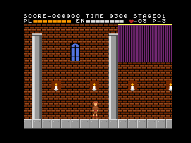

# Castlevania (NES) → MSX turbo R

A fan project to port the NES game *Castlevania* (Konami, 1986) to the
MSX turbo R, written in Z80/R800 assembly.



**Status: milestone 0, the engine skeleton.** The game engine already
scrolls a castle level with a fixed HUD and has a controllable 3-colour
character. All graphics shown are **original placeholders**. No Konami
data is included or committed. See [docs/ROADMAP.md](docs/ROADMAP.md).

## Legal

*Castlevania* is © Konami. This repository contains only original code
and placeholder art. Game data (graphics, levels, music) will be
converted at build time from a ROM image you own; it must never be
committed here. `*.nes` files and `build/` are git-ignored.

## Building

Requirements:

- [sjasmplus](https://github.com/z00m128/sjasmplus) 1.20 or newer
- Python 3.8+
- [openMSX](https://openmsx.org/) to run and test

```bash
make
```

This creates `build/cvmsx.rom`, a 128 KB **ASCII16** MegaROM.

## Running

On the free C-BIOS MSX2+ machine (V9958 with a 3.58 MHz Z80, no system ROMs needed):

```bash
make run-cbios
```

On a real turbo R configuration (you'll need the FS-A1GT system ROMs installed in openMSX):

```bash
make run
```

Controls: cursor keys or joystick to walk; SPACE or button A to jump.
Jumps are committed, like in the original: you can't steer in mid-air.

## Testing

```bash
make test
```

This boots the ROM headless in openMSX (using `xvfb-run` if there is no display),
walks, jumps and turns. It checks the game state in RAM (60 fps main
loop, line-interrupt split, scrolling, physics) and saves screenshots to `build/test/`.

## Layout

```
src/        Z80 / R800 assembly (engine)
  main.asm      ROM header, init, main loop, bank layout
  vdp.asm       V9958 setup and VRAM helpers
  irq.asm       VBLANK + line interrupt (HUD/playfield scroll split)
  scroll.asm    column streaming, camera, tile collision
  player.asm    player physics, animation, sprites
  hud.asm       status bar
tools/
  gen_placeholder_assets.py   original placeholder art and test level
  nes_rom_tool.py             inspect / split / tile-view YOUR NES ROM
tests/
  run_smoke.py  headless openMSX test
docs/
  DESIGN.md     how NES features map to the MSX turbo R
  ROADMAP.md    milestones
```

## Working with your NES ROM

```bash
python3 tools/nes_rom_tool.py info castlevania.nes
```

```bash
python3 tools/nes_rom_tool.py split castlevania.nes build/nes
```

```bash
python3 tools/nes_rom_tool.py tiles castlevania.nes build/nes/bank1.png --bank 1
```
